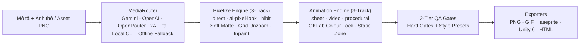

# Pixel Forge — Unified 2D Pixel Art & Animation Studio

**Pixel Forge** (`pixel-forge`) là bộ công cụ Python + CLI + Agent Skills hợp nhất giúp bạn:

1. **Vẽ Asset 2D Pixel Art** từ mô tả văn bản và/hoặc hình ảnh phác thảo thô (`ai-pixel-look`, `hibit`, hoặc `direct` chạy offline 0 đồng).
2. **Tạo Animation mượt mà** từ ảnh Asset đã có + mô tả chuyển động qua 3 chiến lược (`sheet` img2img, `video` Image-to-Video → lattice snap + OKLab colour lock, hoặc `procedural` offline).
3. **Kiểm định chất lượng tự động 2 tầng (QA Gates)**: 0 anti-aliasing, chuẩn lưới, sạch viền chroma-key, giới hạn bảng màu, orphan pixels, banding/jaggies, và khóa Static Zone.
4. **Xuất xưởng trọn bộ định dạng không cần cài Aseprite CLI**:
   - **PNG** (khung hình rời, spritesheet ngang/lưới, PNG-8 indexed, ảnh phóng đại nearest-neighbor, `atlas.json`, `spatial.json`).
   - **GIF động trong suốt sắc nét** (`disposal=2`, dành riêng slot trong suốt 255, chống bóng ma).
   - **`.aseprite` nhị phân thuần Python** (đầy đủ layer `Main` + `Shadow`, cel nén zlib RGBA, animation tag, pivot slice).
   - **Gói Unity 6 sẵn dùng** (Textures + `PixelForge.job.json` + `Editor/PixelForgeImporter.cs` tự cấu hình `FilterMode.Point`, `Uncompressed`, cắt sheet qua `ISpriteEditorDataProvider` + `ISpriteFrameEditCapability`, tạo `AnimationClip`, `AnimatorController` và `Prefab`).
   - **HTML Previewer không cần server** (`sprite_sheet.html`, `palette_viewer.html`, `tilemap_preview.html`).

---

## Kiến trúc tổng quan



---

## Cài đặt nhanh

Yêu cầu: **Python 3.10+** (khuyến nghị cài thêm **FFmpeg** nếu dùng `--track video`). Không cần cài Aseprite CLI.

```powershell
# Cài ở chế độ editable để dùng lệnh `pixelforge` ở mọi nơi
pip install -e .

# Hoặc chạy trực tiếp không cần cài
$env:PYTHONPATH = "src"
python -m pixel_forge doctor
```

---

## Dùng ngay trong 30 giây (Chạy Offline 100%, 0 đồng)

```powershell
# 1. Kiểm tra môi trường, bảng màu, presets và API keys
python -m pixel_forge doctor

# 2. Chuyển ảnh sketch/ảnh thô thành Pixel Art 32x32 + xuất PNG, GIF, .aseprite, Unity
python -m pixel_forge asset "wooden treasure chest with gold trim" `
  --rough sketch.png --size 32x32 --mode direct --preset topdown-34-stardew `
  --formats png,gif,aseprite,unity --out output/chest

# 3. Tạo animation từ ảnh asset vừa tạo (offline procedural)
python -m pixel_forge animate output/chest/png/chest.png "chest opening with golden glow" `
  --action open --frames 6 --fps 8 --playback once --track procedural `
  --formats png,gif,aseprite,unity --out output/chest_open

# 4. Kiểm định QA 2 tầng & kiểm tra cấu trúc nhị phân file .aseprite
python -m pixel_forge audit output/chest_open --preset topdown-34-stardew
python -m pixel_forge inspect-aseprite output/chest_open/aseprite/chest_open.aseprite
```

---

## Bộ 7 Slash Commands gọi nhanh (Antigravity / Claude Code / Codex)

Toàn bộ workflow đã được đóng gói thành các skill chuẩn trong `.agents/skills/` để bạn gọi trực tiếp bằng dấu `/` trong khung chat AI Agent:

| Slash Command | Tác dụng |
|---|---|
| `/pf-asset` | Vẽ hoặc chuyển đổi ảnh thô thành 2D Pixel Art asset + QA + xuất PNG/GIF/`.aseprite`/Unity |
| `/pf-animate` | Tạo animation từ ảnh asset có sẵn + mô tả (`sheet` / `video` / `procedural`) |
| `/pf-export` | Đóng gói thư mục frames hoặc spritesheet sang PNG + GIF + `.aseprite` + Unity + Lua |
| `/pf-audit` | Chạy kiểm định QA 2 tầng và gợi ý cách sửa lỗi pixel art (alpha, fringe, palette, banding) |
| `/pf-inpaint` | Chỉnh sửa cục bộ theo mask đen-trắng, khóa 100% byte RGBA ngoài mask |
| `/pf-unity` | Đóng gói chuẩn Unity 6 (`PixelForgeImporter.cs`) + hướng dẫn `PixelPerfectCamera` |
| `/pf-doctor` | Kiểm tra Python, FFmpeg, API keys (ẩn secret), bảng màu, presets và chi phí `.forge/ledger.jsonl` |

---

## Bảng lệnh CLI chính

| Lệnh | Mô tả |
|---|---|
| `pixelforge doctor` | Kiểm tra môi trường, provider routes, FFmpeg, ngân sách |
| `pixelforge presets` | Liệt kê 8 Style Presets (`topdown-34-stardew`, `side-view-hibit`, `retro-pico8`...) |
| `pixelforge asset "<brief>"` | Tạo Asset 2D Pixel từ mô tả & ảnh thô (`--rough`, `--mode`, `--size`, `--preset`) |
| `pixelforge animate <png> "<brief>"` | Tạo Animation từ ảnh asset (`--action`, `--frames`, `--fps`, `--track`) |
| `pixelforge export` | Xuất lại frames/spritesheet sang `png,gif,aseprite,unity,lua,html` |
| `pixelforge inpaint "<prompt>"` | Inpaint theo mask bảo vệ 0 pixel thay đổi ngoài mask |
| `pixelforge audit <path>` | Kiểm định QA 2 tầng cho ảnh đơn hoặc bộ animation |
| `pixelforge inspect-aseprite <file>` | Giải mã & xác thực cấu trúc nhị phân file `.aseprite` |
| `pixelforge palette list\|extract\|remap` | Xem 11 bảng màu chuẩn, trích xuất palette, hoặc remap màu ảnh |
| `pixelforge dither` / `pixelforge noise` | Tạo gradient Bayer dither và tile value noise liền mạch |

---

## Cấu trúc thư mục xuất xưởng (`output/<asset_id>/`)

```text
output/<asset_id>/
├── png/          # Ảnh PNG tĩnh & PNG-8 indexed
├── frames/       # Từng khung hình RGBA đánh số chuẩn
├── sheet/        # Spritesheet PNG ngang/lưới
├── gif/          # GIF động trong suốt (1x và 4x preview)
├── aseprite/     # File nhị phân .aseprite thuần Python (mở trực tiếp trong Aseprite)
├── unity/        # Gói Unity 6 (Textures/, PixelForge.job.json, Editor/PixelForgeImporter.cs, UNITY_SETUP.md)
├── metadata/     # atlas.json, spatial.json, palette.json, qa.json, qa.md
└── preview/      # review_sheet.png đánh số + HTML viewers không cần server
```

---

## Tài liệu chi tiết

- **Hướng dẫn sử dụng từ Cơ bản đến Nâng cao**: [docs/USER_GUIDE.md](docs/USER_GUIDE.md)
- **Bộ luật Art Director & Vật lý Pixel Art**: `.agents/rules/`
- **Chạy kiểm thử tự động**:
  ```powershell
  $env:PYTHONPATH = "src"
  python -m unittest discover -s tests -v
  ```
